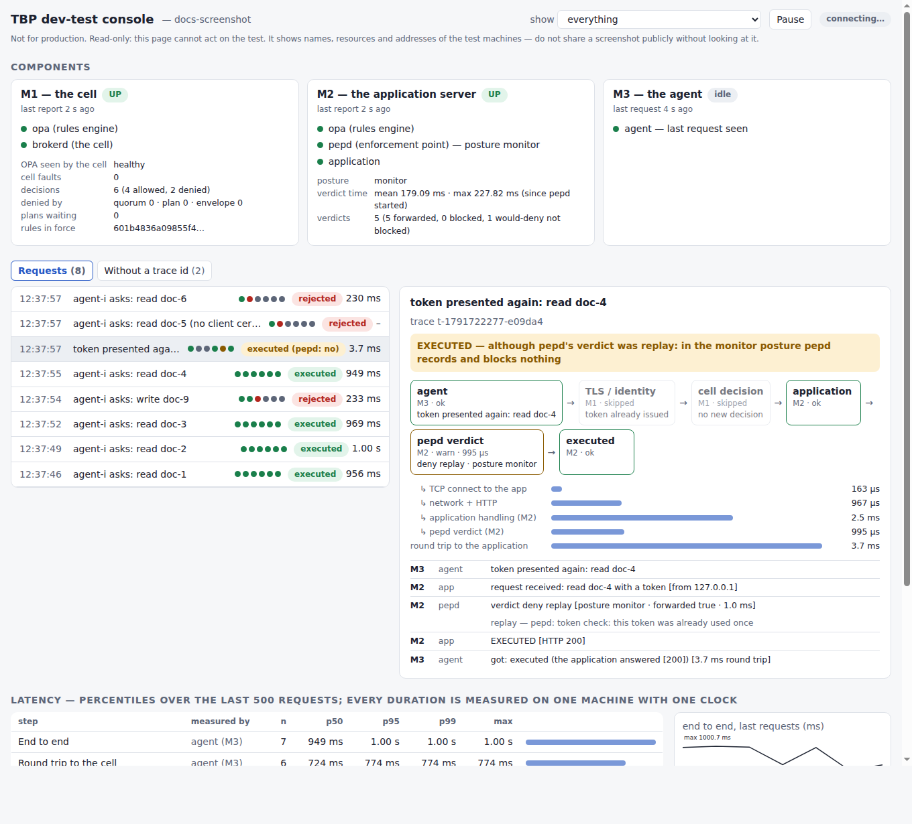

# The live console: watch a request cross the three machines, in a browser

_Version française : [console.fr.md](console.fr.md). Part of [deploy/dev-test](README.md); the machines are described
in [site.md](site.md)._

> **Not for production.** The console is a test tool: it shows names, resources and addresses of your test machines
> in clear, over plain HTTP, behind a key. It is **read-only**: nothing on the page can act on the test.

You deploy the three machines, open **one address** in a browser, and see — as you act — **the path** of each request
(agent → TLS and identity → the cell's decision → the application → `pepd` → executed or rejected), **the state** of each
component, and **the latency** of every step.



## Open it

`m1 up` prints the address, with its key:

```
site M1: up. Agents reach the cell at https://10.0.0.5:8443 (mutual TLS).
         the live console (open it in a browser): http://10.0.0.5:9100/?key=07a79b9cd60a7332e79ab8c779273240
```

Open that address from your own machine. (`site.sh m1 console-url` prints it again.) The key is stored in a cookie
and removed from the address bar. Two keys exist and they differ: the one in the address **opens the page**; another
one **lets M1, M2 and M3 send** what they see. Whoever can send cannot read, and whoever can read cannot send.

The console runs **on M1 by default**, and **listens on M1's address, port 9100**. It needs three network flows, in
addition to those of [site.md](site.md#the-network):

| From → to | Port | What | Open to |
|---|---|---|---|
| you (browser) → the console | 9100/tcp | the page | your address only |
| M2 → the console | 9100/tcp | M2's events and component state | M2's address only |
| M3 → the console | 9100/tcp | M3's events | M3's address only |

(M1's own events never leave M1 when the console is there.) Firewall port 9100 like 22: your address and the three
machines, **nothing from the Internet**.

### On a machine of its own, or anywhere else

"On M1 or elsewhere": the console can run on any machine that M1, M2, M3 and your browser can reach — a fourth machine,
or your laptop. Give M1 the address at `init`, then start the console there with the same key:

```bash
KEY=$(openssl rand -hex 16)
# on M1 (instead of the default console on M1):
scripts/devtest/site.sh m1 init --address <M1> --console-url http://<C>:9100 --console-key "$KEY" --env "…"
# on the machine C (Go, `curl`, `openssl`; the repository):
scripts/devtest/site.sh console up --listen <C>:9100 --ingest-key "$KEY"      # prints the address to open
```

M2 and M3 learn the address and the key from their packs: nothing else to configure. `console down`, `console url`,
`console status` and `console reset` do what they say.

## What the page shows

**Components.** One card per machine, with each component's state and **how long ago it last reported**:
`M1` — OPA and `brokerd` (decisions so far, refusals by cause, faults of the cell itself, the rules in force, plans
waiting); `M2` — OPA, `pepd` (its **posture**, `monitor`/`closed`/`refused`, verdicts and their mean and maximum time) and
the application; `M3` — the agent, which has no daemon: it is `idle`, never `down`, and the card says when it last acted.
**A machine that stops reporting turns `UNKNOWN` after 8 seconds — it is never left green.**

**Requests.** Newest first. Each row: the time, what was asked, a mini path of six dots, how it ended, the end-to-end
time. Filter by outcome, **Pause** to read, click a row to open it (its address gets `#<trace id>`: you can send it to
someone).

**The path of the selected request.** Six steps — *agent → TLS / identity → cell decision → application → pepd verdict →
executed* — each green (passed), amber (passed although `pepd` said no: the monitor posture), red (**this is where it
was stopped**), or grey (not reached, or not yet). Under it, **the last line says how it ended and why**, in words:
*"REJECTED by the cell (M1) — plan-binding-required — the cell: plan contract: an action of class I or W needs a plan
approved by operators, and none was given"*. Every reason code is explained
([`reasons.tsv`](../../scripts/devtest/reasons.tsv)).

**The latency of the selected request**, step by step, and **the percentiles over the last 500 requests** (p50, p95,
p99, max) in the table below.

**Without a trace id.** A client that is not our scripts — `curl`, a scanner, a red team — sends no trace id. What the
cell and the application saw of it is listed here, one line per event, with the certificate presented and the address it
came from. This is where **your own attack** appears.

## How the latency is measured

Each duration is measured **on one machine, with one clock**, so no comparison of the three machines' clocks is ever
needed (they differ):

| Step | Measured by | How |
|---|---|---|
| TCP connect, TLS handshake | M3 | `curl`'s own timers |
| **network + HTTP** to the cell | M3 and M1 | M3's wait for the first byte, **minus** the cell's decision time |
| **cell decision** | M1 (`brokerd`) | from reading the request to the verdict |
| round trip to the cell | M3 | `curl`'s total |
| **network + HTTP** to the application | M3 and M2 | M3's wait, minus the application's handling time |
| **application handling** | M2 (the application) | from receiving the request to answering |
| **`pepd` verdict** | M2 (`pepd`) | `pepd`'s own measure of its verdict |
| round trip to the application | M3 | `curl`'s total |
| end to end | M3 | both round trips added (it leaves out the time between them) |

"Network + HTTP" is what is left of a wait once the far side's own work is taken out: the network, the HTTP stack and
the queueing. If it is large, look at the network; if the cell decision or the `pepd` verdict is large, look at that
component. The order of a request's lines follows the steps it went through, not the clocks.

## Reading the rest

**The ending of a request:**

| It says | Meaning |
|---|---|
| `EXECUTED` | the application acted |
| `EXECUTED — although pepd's verdict was …` | `pepd` said no but the posture is `monitor`: it records and blocks nothing. Close it to block ([monitor-to-closed.md](../monitor-to-closed.md)) |
| `REJECTED by the cell (M1) — <reason> — <where>: <why>` | the cell refused: no token was issued |
| `REJECTED at the TLS handshake (M1)` | no (or wrong) client certificate: the cell never saw a request |
| `REJECTED by pepd (M2) — <reason> …` | the token was bad, replayed or for something else, **and** the posture blocks (`closed`/`refused`) |
| `REJECTED by the application (M2) — no-token` | the request carried no token |
| `TOKEN ISSUED by the cell, not presented …` | the agent got a token and did not use it (or the machine that would show it is not reporting) |
| `INCOMPLETE — no end seen …` | a machine took part and is not reporting to this console |

A refused TLS handshake never becomes a request on the cell: `brokerd`'s log is the only one that knows it, and the
shipper on M1 reads it. It is attached to the request an agent made without a certificate when they are within 3
seconds, and the line says so.

## Recipes

**"My request was refused and I do not know why."** Run `m3 act …` and look at the console: the request is the top
row, the red step is the component that stopped it, the last line says why.

**"I attack the cell with `curl`."** Run your attack; open the tab *Without a trace id*. A connection refused at the
TLS handshake shows as `transport … TLS handshake failed`.

**"I close `pepd`: what changes?"** Make the same request before and after, and compare the two rows: the amber
*pepd verdict* step turns red, the ending turns from *EXECUTED — although …* to *REJECTED by pepd*.

**"Where does the time go?"** Make 20 requests, then read the percentiles table. The step with the biggest p95 is the
one to look at.

**"A card says UNKNOWN."** That machine has stopped reporting: its shipper is down, it cannot reach the console (the
firewall), or the machine is down. `site.sh m2 status` on it. UNKNOWN is never a good sign.

## Without a browser

The same information, in a terminal on M1 — useful over a bad link, or for a record. They read files and sockets; none of
them changes the test.

| Command | Shows |
|---|---|
| `scripts/devtest/site.sh m1 watch` (`--every 5` repeats it) | the cell's status page: processes, rules, decisions, faults, plans waiting (by hash), audit journal. A source that does not answer is `UNKNOWN`, and the exit status is non-zero |
| `scripts/devtest/site.sh m2 trace-export` and `m3 trace-export` | pack what that machine recorded, to copy to M1 |
| `scripts/devtest/site.sh m1 trace --from trace-m2.tgz --from trace-m3.tgz [--id t-…]` | one timeline per request, with the same endings as the page (a test checks they agree). Requests that carry no id are listed apart, under *without a trace id*; a request of which a machine's file is missing ends *INCOMPLETE* |
| `scripts/devtest/site.sh m1 sign <agent> <action> <resource>` | **the only place where a person approves something**: it shows the plan in clear, recomputes its hash, asks you to type `sign` |

Every `m3 act` prints a trace id (`[trace t-…]`): the same id travels to the cell and to the application in the header
`X-TBP-Trace-Id`, which is how three machines' records are joined.

## What it does not do

- **It does not act.** No button approves, revokes, closes `pepd` or signs. Signing stays in `m1 sign`, closing and
  reopening in `m1 mode-proof` and `m2 mode`. A real operator console — what it should do and show — is the open question
  of [#329](https://github.com/philippeabraxas-jpg/TBP-NETWORK/issues/329): tell us what you missed.
- **It does not keep a history.** It holds the last 2000 requests **in memory**. Restarting the console empties it;
  `m1 down` then `m1 up` restart it and replay M1's recorded events, `m2 down` then `m2 up` replay M2's (the files are
  kept); M3's events are not replayed.
- **It is not authenticated like a production service.** Plain HTTP, two secret keys: use a private network and a
  firewall. Everything a request carries — subject, resource, intent, addresses — is shown **as text**, never as page
  content: a red team can fill them with anything, the page does not run it (a test opens the page in a real browser to
  check). Do not paste a screenshot of the page in a public issue without looking at it.
- **Clocks.** Offsets between machines are not shown, because they would mislead. Durations are, because each is
  measured by one machine.
- **`pepd`'s own view.** The `pepd` lines are the verdict it returned to the application, and its counters. `pepd` itself
  is not modified, and M2 has no development switch for the console. The cell, M1, does: its decision trace is the
  second development switch (`TBP_DECISION_TRACE_DEV`, behind the same sentinel as the issuer seed).
